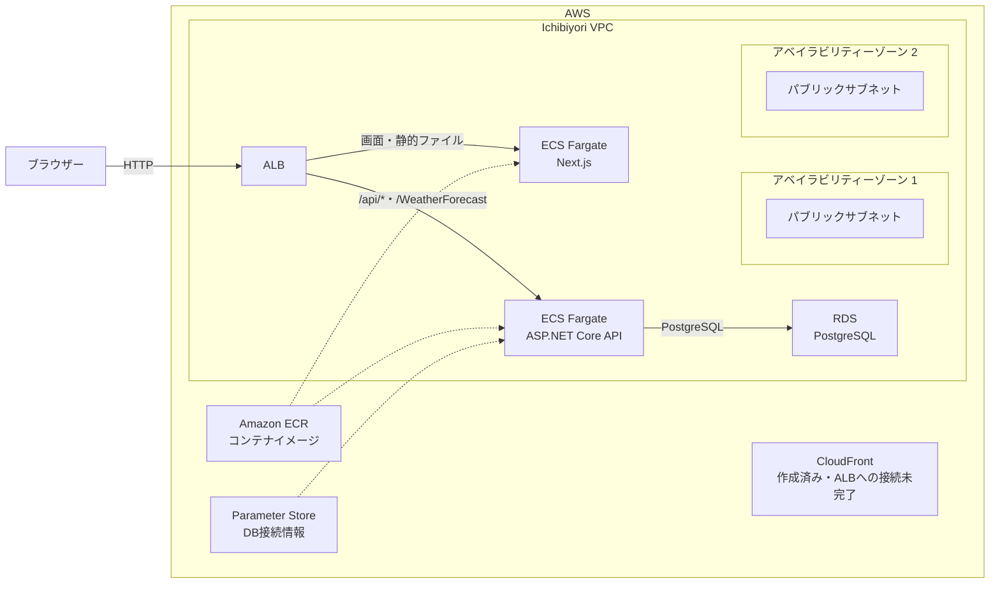

# Ichibiyori

釣果を記録・共有し、釣り人同士で次の釣行のヒントを見つけるWebアプリです。

## AWS構成

現在はALBに直接HTTPで接続し、画面とAPIの動作を確認しています。



図はサービス間の接続とVPC内の2つのAZを概略として示しています。各タスクやRDSの現在の配置先AZ、複数AZでの稼働を示すものではありません。

CloudFrontは作成済みですが、ALBへの接続設定は未完了です。現在のCloudFrontのオリジン設定はHTTPで、独自ドメインと証明書も未設定です。

公開に向けて、独自ドメインと証明書を用意し、ブラウザーからCloudFront、CloudFrontからALBまでをHTTPSにする予定です。HTTPS化と公開前のセキュリティ確認が完了するまでは、実際のパスワードや個人情報を入力しないでください。


## コンテナでの実行

Docker Desktopが起動している状態で、フロントエンドのディレクトリから実行します。

```powershell
docker build -t ichibiyori-front:latest .
docker run --rm -p 3000:3000 ichibiyori-front:latest
```

`http://localhost:3000`で画面を確認できます。Dockerイメージには`.env`ファイルを含めません。API接続先の既定値`localhost:5187`はコンテナ自身を指すため、このコマンドだけでは通常、ホスト側のAPIには接続できません。

AWSではALBで`/api/*`をAPIのターゲットグループへ、それ以外をNext.jsのターゲットグループへ転送する想定です。CloudFrontからALBまでHTTPとする学習構成では、実際のパスワードや個人情報を送信しないでください。

## ソース構成

| 場所 | 役割 |
| --- | --- |
| `app` | App RouterのURLごとのページと共通レイアウト |
| `src/components` | 共通コンポーネントと画面コンポーネント |
| `src/contexts` | 複数画面で共有する認証・釣果状態 |
| `src/services` | バックエンドAPIとの通信 |
| `src/types` | APIレスポンスや画面間で共有する型 |
| `src/data` | 魚種図鑑などの静的データ |
| `src/utils` | 日付表示など、画面に依存しない処理 |
| `public` | 魚種図鑑などの静的ファイル |

複数画面で共有する釣果・認証状態は`src/contexts/AppContext.tsx`のプロバイダーで管理し、画面遷移は`app`のApp Routerで行います。HTTP通信の詳細は`src/services`に集めます。
