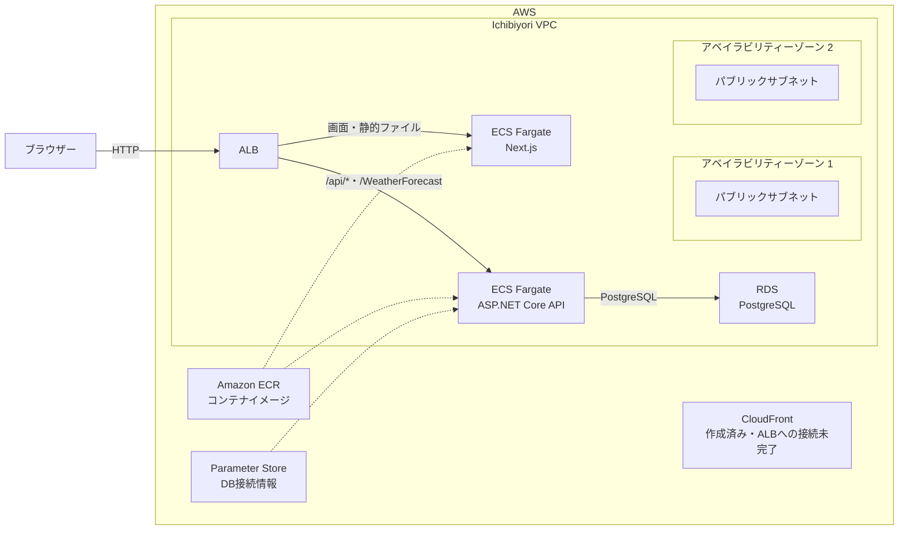

# Ichibiyori

釣果を記録・共有し、釣り人同士で次の釣行のヒントを見つけるWebアプリです。

## AWS構成

現在はALBに直接HTTPで接続し、画面とAPIの動作を確認しています。



図はサービス間の接続とVPC内の2つのAZを概略として示しています。各タスクやRDSの現在の配置先AZ、複数AZでの稼働を示すものではありません。

CloudFrontは作成済みですが、ALBへの接続設定は未完了です。現在のCloudFrontのオリジン設定はHTTPで、独自ドメインと証明書も未設定です。

公開に向けて、独自ドメインと証明書を用意し、ブラウザーからCloudFront、CloudFrontからALBまでをHTTPSにする予定です。HTTPS化と公開前のセキュリティ確認が完了するまでは、実際のパスワードや個人情報を入力しないでください。

## 概要書

釣り人が釣果を写真と情報付きで投稿し、ほかのユーザーが釣果を閲覧・検索できるWebアプリを提供する。

初期版では、次の一連の体験を成立させる。

```text
釣果を見る → 条件で探す → 詳細を確認する → 自分の釣果を投稿する → 振り返る
```

### 対象ユーザー

#### 未ログインユーザー

- 釣果一覧を閲覧できる
- 釣果を条件で絞り込める
- 釣果の詳細を閲覧できる
- 会員登録・ログインができる

#### ログインユーザー

- 未ログインユーザーの機能を利用できる
- 釣果を投稿できる
- 自分の投稿を編集・削除できる
- 自分の投稿をマイページで確認できる
- 投稿にいいねを付けたり外したりできる

###対象範囲

#### 対象とする釣り

海釣り、川釣り、湖釣りを対象とする。初期版では、特定の釣り方や魚種に限定しない。

#### 初期版の対象機能

- 会員登録、ログイン、ログアウト
- 釣果の投稿
- 釣果の一覧表示
- 釣果の詳細表示
- 釣果の絞り込み
- 自分の投稿の管理
- いいね
- 釣り場情報の公開範囲設定

#### 初期版の対象外

以下は初期版では実装しない。

- コメント
- フォロー
- ダイレクトメッセージ
- 地図上での釣り場表示
- 天気・潮汐情報との自動連携
- ランキング
- 通知
- 課金

### 機能要件

#### 会員登録

- ユーザーはメールアドレスとパスワードで会員登録できる
- メールアドレスは重複登録できない
- 入力不備がある場合はエラーを表示する

#### ログイン・ログアウト

- 登録済みのユーザーはログインできる
- ログイン中のユーザーはログアウトできる
- 認証に失敗した場合はエラーを表示する
- 未ログインユーザーは投稿の作成・編集・削除を実行できない

#### 釣果一覧表示

- 釣果を一覧表示できる
- 初期表示は新しい投稿順とする
- 一覧には写真、魚種、釣れた日、地域、いいね数を表示する
- 投稿が存在しない場合は空状態を表示する
- データ取得中はローディング状態を表示する
- データ取得に失敗した場合はエラー状態を表示する

#### 釣果の絞り込み

- 魚種で絞り込める
- 釣り方で絞り込める
- 地域で絞り込める
- 絞り込み条件を解除できる
- 絞り込み結果が0件の場合は、その旨を表示する

#### 釣果詳細表示

- 釣果の写真を表示できる
- 魚種、サイズ、重さ、釣れた日を表示できる
- 釣り方、ルアー・エサ、地域、コメントを表示できる
- 釣り場情報の公開設定に応じて位置情報を表示する
- 投稿者名を表示する
- いいね数といいね状態を表示する

#### 釣果投稿

ログインユーザーは釣果を投稿できる。

##### 必須入力

- 写真：1枚以上
- 魚種
- 釣れた日

##### 任意入力

- 写真：最大3枚まで
- サイズ
- 重さ
- 釣り方
- ルアー・エサ
- 地域
- コメント

##### 投稿時の条件

- 必須項目が未入力の場合は登録できない
- 写真は許可された形式のみ登録できる
- 写真の容量が上限を超える場合は登録できない
- 釣れた日に未来の日付は指定できない
- 釣り場情報の公開範囲を選択できる
- 公開範囲の初期値は「地域のみ公開」とする

#### 釣果編集・削除

- 投稿者本人は自分の釣果を編集できる
- 投稿者本人は自分の釣果を削除できる
- 他ユーザーの投稿は編集・削除できない
- 削除前に確認を表示する

#### マイページ

- ログインユーザーはマイページを表示できる
- 自分の投稿を一覧表示できる
- 自分の投稿数を表示できる
- 各投稿から詳細、編集、削除を実行できる

#### いいね

- ログインユーザーは投稿にいいねを付けられる
- 付けたいいねを外せる
- 同じ投稿に複数回いいねできない
- 投稿ごとのいいね数を表示する

#### 公開範囲の制御

釣り場情報について、投稿者は以下から公開範囲を選択できる。

- **非公開**：投稿者本人のみ詳細な釣り場情報を確認できる
- **地域のみ公開**：都道府県や地域など、大まかな情報だけ公開する
- **詳細を公開**：入力した詳細情報を公開する

### 画面要件

#### 釣果フィード

- 新着釣果を一覧表示する
- 魚種、釣り方、地域で絞り込める
- 投稿詳細へ遷移できる
- ログインユーザーは投稿画面へ遷移できる
- ログイン状態に応じてログイン・マイページを表示する

#### 投稿詳細

- 写真と釣果情報を表示する
- 公開範囲に応じた地域情報を表示する
- いいね操作ができる
- 投稿者本人の場合、編集・削除操作を表示する

#### 釣果投稿

- 写真を最大3枚選択できる
- 入力エラーを項目ごとに表示する
- 公開範囲を選択できる
- 投稿成功後、投稿詳細または釣果フィードへ遷移する

#### 釣果編集

- 既存の投稿内容を初期表示する
- 投稿内容を変更できる
- 編集成功後、投稿詳細へ遷移する

#### マイページ

- 自分のプロフィール情報を表示する
- 自分の投稿一覧を表示する
- 自分の投稿を編集・削除できる

#### 会員登録

- メールアドレス、パスワードを入力できる
- 入力エラーを表示する
- 登録成功後、ログインまたは釣果フィードへ遷移する

#### ログイン

- メールアドレス、パスワードを入力できる
- 認証エラーを表示する
- ログイン成功後、釣果フィードへ遷移する

### データ要件

#### ユーザー

- ユーザーID
- メールアドレス
- パスワードハッシュ
- 表示名
- 作成日時
- 更新日時

#### 釣果投稿

- 投稿ID
- 投稿者ID
- 魚種
- 釣れた日
- サイズ
- 重さ
- 釣り方
- ルアー・エサ
- 地域
- 詳細な釣り場情報
- 釣り場情報の公開範囲
- コメント
- 作成日時
- 更新日時

#### 釣果写真

- 写真ID
- 投稿ID
- 保存先
- 表示順
- 作成日時

#### いいね

- いいねID
- 投稿ID
- ユーザーID
- 作成日時

同じユーザーが同じ投稿に複数のいいねを登録できないようにする。

### 非機能要件

#### 対応端末

スマートフォン、タブレット、PCのブラウザで利用できること。

#### 入力チェック

フロントエンドとバックエンドの両方で入力値を検証すること。

#### セキュリティ

- パスワードを平文で保存しない
- 認証が必要なAPIを未ログイン状態で実行できない
- 他ユーザーの投稿を編集・削除できない
- アップロードファイルの形式と容量を検証する
- 詳細な位置情報を公開設定に反して表示しない

#### 操作状態

読み込み中、処理成功、入力エラー、通信エラー、データ0件の状態を画面に表示すること。

#### 保守性

画面、API、データモデルの責務を分離し、機能追加しやすい構成にすること。

### 受け入れ条件

#### 閲覧

未ログインユーザーが、釣果一覧と投稿詳細を閲覧できること。

#### 絞り込み

魚種、釣り方、地域の条件で釣果を絞り込めること。条件解除後は全件表示に戻ること。

#### 投稿

ログインユーザーが、写真、魚種、釣れた日を入力して釣果を投稿できること。投稿後、一覧または詳細に投稿が表示されること。

#### 入力エラー

必須項目が未入力の場合や、未来の日付・許可されていない画像を指定した場合に、登録できずエラーが表示されること。

#### 投稿管理

ログインユーザーが自分の投稿を編集・削除でき、他ユーザーの投稿は編集・削除できないこと。

#### 公開範囲

釣り場情報が、投稿者の指定した公開範囲どおりに表示されること。

#### いいね

ログインユーザーが投稿にいいねを付け外しでき、同じ投稿への重複登録が発生しないこと。

#### レスポンシブ対応

主要画面がスマートフォンとPCの両方で操作できること。

## コンテナでの実行

Docker Desktopが起動している状態で、フロントエンドのディレクトリから実行します。

```powershell
docker build -t ichibiyori-front:latest .
docker run --rm -p 3000:3000 ichibiyori-front:latest
```

`http://localhost:3000`で画面を確認できます。Dockerイメージには`.env`ファイルを含めません。API接続先の既定値`localhost:5187`はコンテナ自身を指すため、このコマンドだけでは通常、ホスト側のAPIには接続できません。

AWSではALBで`/api/*`をAPIのターゲットグループへ、それ以外をNext.jsのターゲットグループへ転送する想定です。CloudFrontからALBまでHTTPとする学習構成では、実際のパスワードや個人情報を送信しないでください。

## ソース構成

| 場所 | 役割 |
| --- | --- |
| `app` | App RouterのURLごとのページと共通レイアウト |
| `src/components` | 共通コンポーネントと画面コンポーネント |
| `src/contexts` | 複数画面で共有する認証・釣果状態 |
| `src/services` | バックエンドAPIとの通信 |
| `src/types` | APIレスポンスや画面間で共有する型 |
| `src/data` | 魚種図鑑などの静的データ |
| `src/utils` | 日付表示など、画面に依存しない処理 |
| `public` | 魚種図鑑などの静的ファイル |

複数画面で共有する釣果・認証状態は`src/contexts/AppContext.tsx`のプロバイダーで管理し、画面遷移は`app`のApp Routerで行います。HTTP通信の詳細は`src/services`に集めます。
