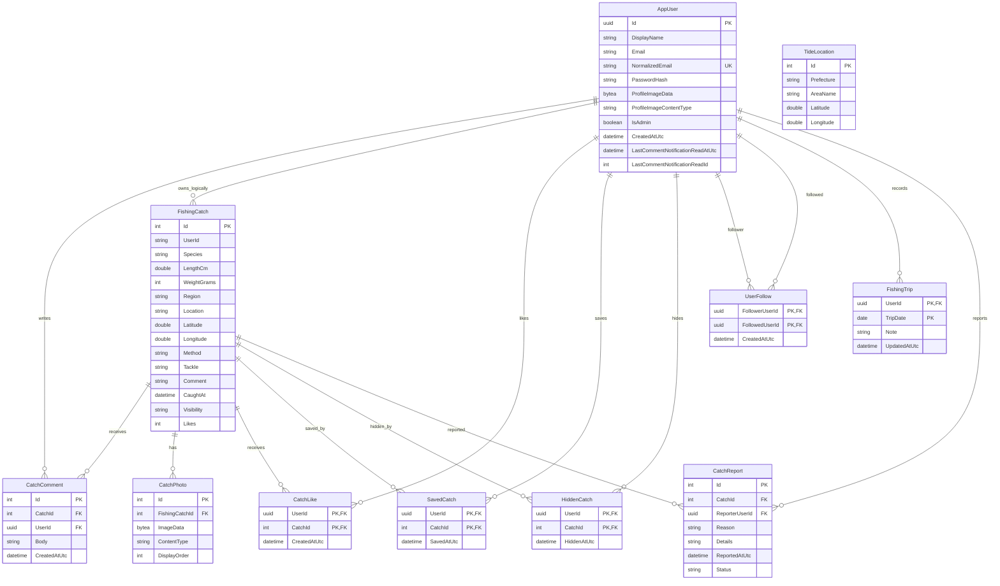

# Ichibiyori Backend

ASP.NET Core 8、Entity Framework Core、PostgreSQLで構成するAPIです。

## データベース構成

PostgreSQLの主な保存テーブルと関係です。

- この図には永続エンティティ11個を示しています。`FishingCatch.UserId`は既存モデル上の文字列参照で、`AppUser.Id`へのDB外部キーではありません。その他の図示した関係はEFの外部キーです。
- `CatchPhoto.FishingCatchId`はEFが作るnullableなシャドウ外部キーで、C#モデルにはプロパティとして宣言されていません。
- `FishingCatch.IsMine`、`Liked`、`IsSaved`、`IsHidden`、`IsReportedByCurrentUser`、`Author`は`[NotMapped]`の応答用値で、DB列ではありません。
- `FishingCatch.Likes`は集計表示用カウンター、`CatchLike`はユーザーごとのいいね状態です。
- コメント通知は独立テーブルではなく、`CatchComment`と`AppUser.LastCommentNotificationReadAtUtc`/`LastCommentNotificationReadId`から算出します。
- `TideDetail`は潮汐API応答用モデルで、DBには保存しません。潮汐地点は`TideLocation`に保存します。
- 起動時のDB更新は`DatabaseInitializer`の冪等SQLを使用しています。現行モデルスナップショットには、`FishingTrip`、`CatchLike`、通知カーソル列がまだ反映されていないため、EFマイグレーションを生成・適用する場合はこの差を解消してください。